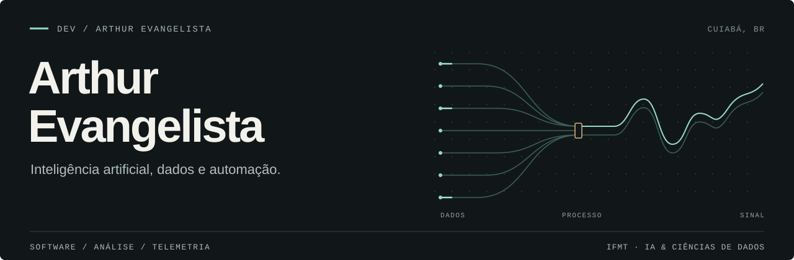

  

[LinkedIn](https://www.linkedin.com/in/oarthurevangelista/) &nbsp; / &nbsp; [E-mail](mailto:devarthurevangelista@gmail.com) &nbsp; / &nbsp; [GitHub profissional](https://github.com/ArtSantosBF)

Estudo **Inteligência Artificial e Ciências de Dados no IFMT** e trabalho com **Inteligência de Negócio e Suprimentos na Bom Futuro**, em Cuiabá.

No trabalho, lido com processos, consultas SQL e automação. Nos projetos pessoais, essa curiosidade vai de ferramentas para Windows à telemetria de simuladores de corrida. Gosto de construir algo que eu mesmo queira usar — e melhorar a partir do uso.

## Projetos selecionados

### [Arts LMU Overlay ↗](https://github.com/DevArthurEvangelista/Arts-LMU-Overlay)

Meu interesse por sim racing virou um projeto de software. Um overlay para Le Mans Ultimate com classificação, pedais e comparação de voltas, pensado para entender melhor a pilotagem.

C# · .NET · Telemetria · Windows

### [Arts Capture Record ↗](https://github.com/DevArthurEvangelista/ArtsCaptureRecord)

Gravador de tela e aplicativos para Windows, com webcam e captura de áudio por aplicativo. Um projeto para explorar captura de mídia e os detalhes de uma ferramenta desktop.

Python · C# · Áudio e vídeo · Windows

## Trabalho e estudo

**Na prática** &nbsp; SQL e Oracle para consultar dados; Python e C# nos projetos pessoais; Git para acompanhar as mudanças.

**Na graduação** &nbsp; Estatística, bases de dados e fundamentos de inteligência artificial. Também mantenho meus [exercícios em Java](https://github.com/DevArthurEvangelista/Exercicios_Udemy_Estruturas) como registro dos estudos em programação.

---

Este espaço reúne projetos pessoais e estudos. A atividade profissional fica em <a href="https://github.com/ArtSantosBF">@ArtSantosBF</a>.
